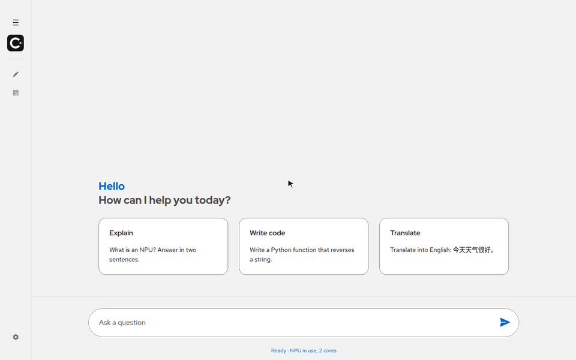
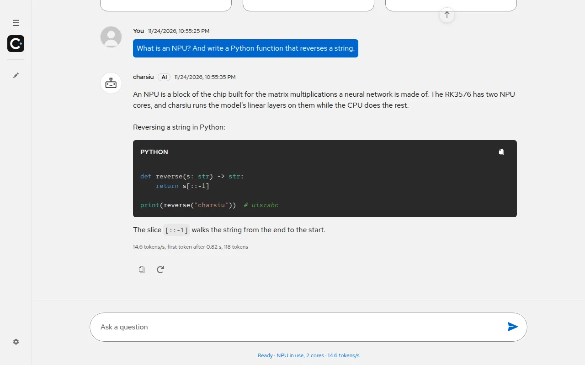
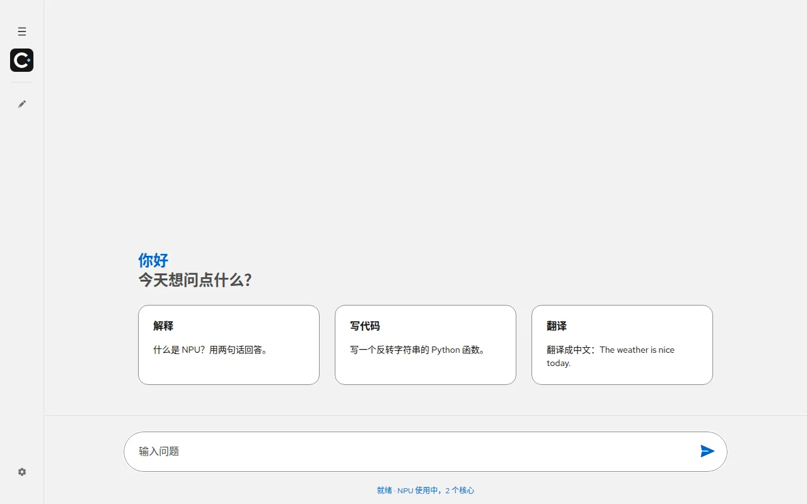
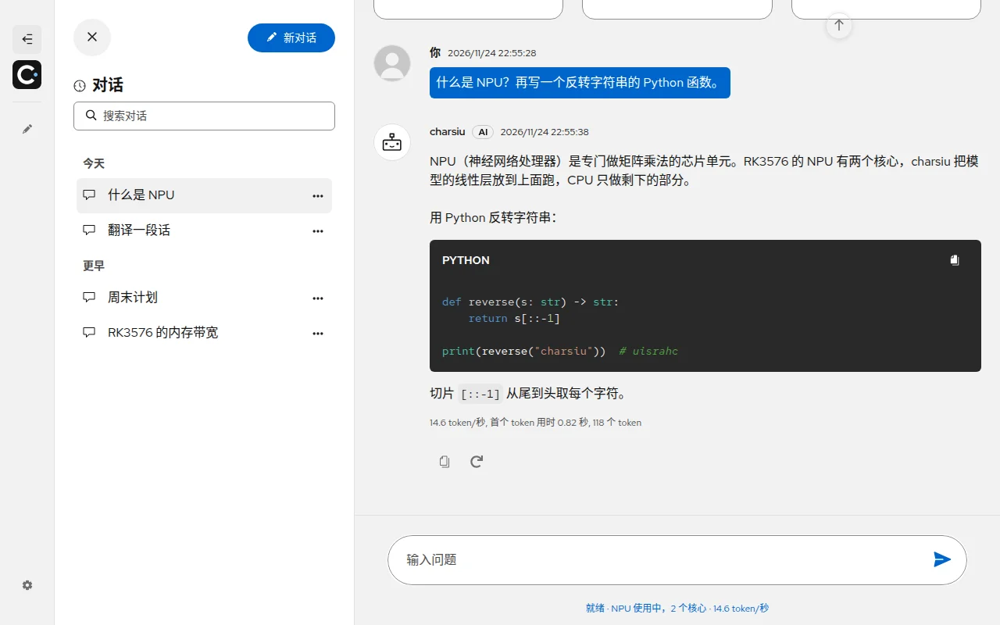
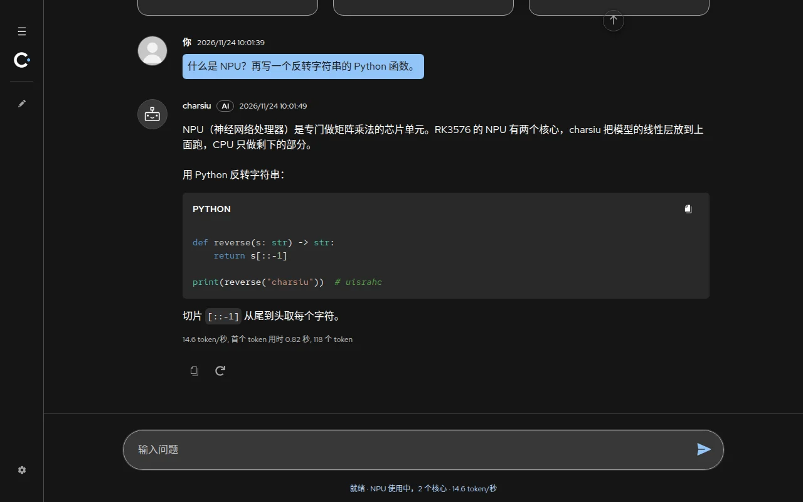

# Charsiu Desktop

[简体中文](README.zh-CN.md)

A chat window for [charsiu](https://github.com/gahingwoo/charsiu), the LLM
runtime for the RK3576 NPU. The model runs on the board, conversations stay
on the board, and no network is needed once a model is downloaded. The same
app runs on Windows on Arm and on Linux.

| | |
|---|---|
|  |  |
|  |  |

## Status

| Feature | Status |
|---|---|
| Streamed chat, Stop, Copy, Regenerate | CI only |
| Conversation history (saved locally, search, rename, delete) | CI only |
| Export a conversation as Markdown | CI only |
| Model list and download (`charsiu pull`) | CI only |
| NPU status in the footnote (Windows and Linux) | CI only |
| English and Simplified Chinese | CI only |

## Requirements

- An RK3576 board with charsiu installed. A model can be downloaded from
  Settings, Model files.
- Windows 11 arm64 with the rknpu driver
  ([woa-rk3576-npu](https://github.com/gahingwoo/woa-rk3576-npu)), or Linux
  arm64 with the mainline rocket driver (Armbian's edge kernel has it).

Without the NPU driver charsiu answers on the CPU, several times slower, and
the app says so.

## Install

Windows:

1. Install charsiu from PowerShell. Run it as administrator once so ordinary
   users may use the NPU:
   `irm https://raw.githubusercontent.com/gahingwoo/woa-rk3576-npu/main/win/charsiu-install.ps1 | iex`
2. Run `charsiu-desktop_<version>_arm64-setup.exe` from the
   [latest release](https://github.com/gahingwoo/charsiu-desktop/releases/latest).
   It installs for the current user.

Linux:

1. `sudo apt install charsiu` on Armbian, or charsiu's installer elsewhere.
2. `sudo apt install ./charsiu-desktop_<version>_arm64.deb` from the
   [latest release](https://github.com/gahingwoo/charsiu-desktop/releases/latest),
   or use `charsiu-desktop_<version>_aarch64.AppImage`.

Check downloads against `SHA256SUMS.txt`
(`sha256sum -c SHA256SUMS.txt --ignore-missing`, or `Get-FileHash` on
Windows). The newest build of main, not tested on a board, is the
[ci pre-release](https://github.com/gahingwoo/charsiu-desktop/releases/tag/ci).

The first start of a model takes about a minute while charsiu writes its
weight cache. Later starts take a few seconds.

Conversations and settings are JSON files in
`%APPDATA%\com.gahingwoo.charsiu-desktop` (Windows) or
`~/.local/share/com.gahingwoo.charsiu-desktop` (Linux). Nothing is uploaded.

How it works, building, CI, releases and the board test checklist:
[docs/development.md](docs/development.md).

## Licence

GPL-2.0-only. PatternFly and the PatternFly Chatbot are MIT, bundled into
dist/ at build time (their licence comments are in dist/app.js.LEGAL.txt).
