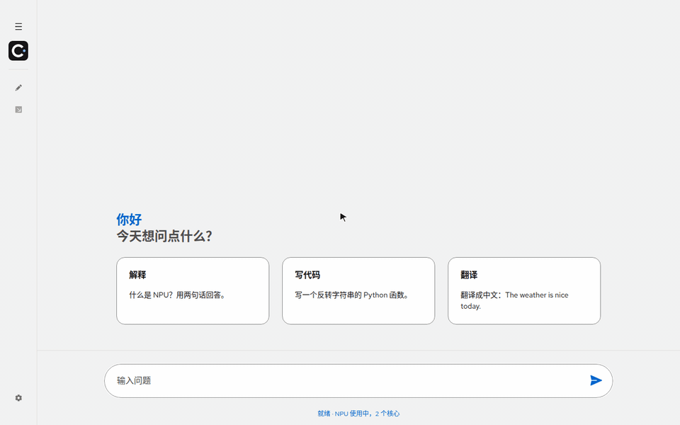
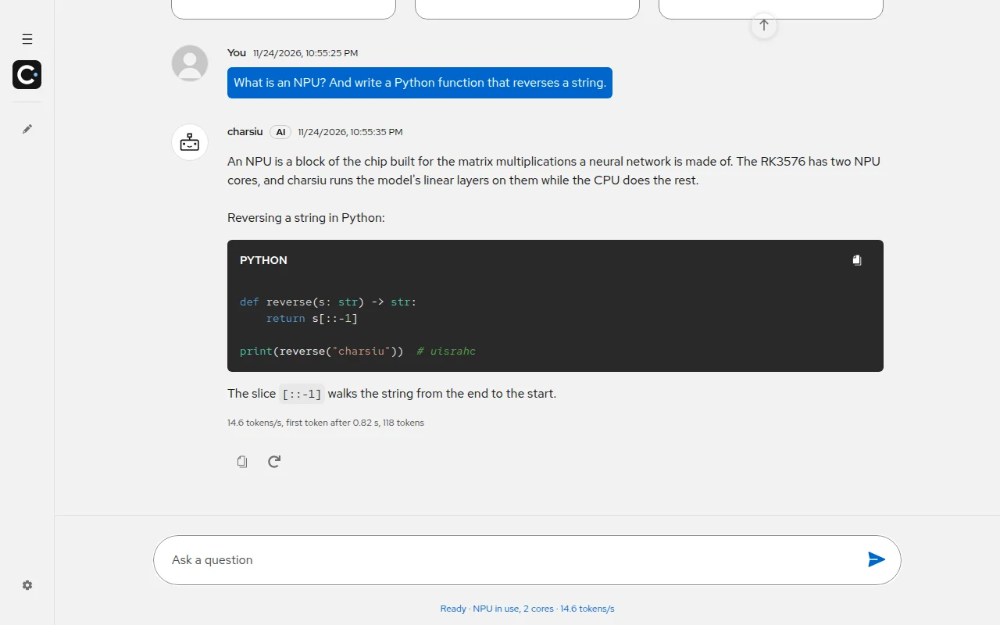
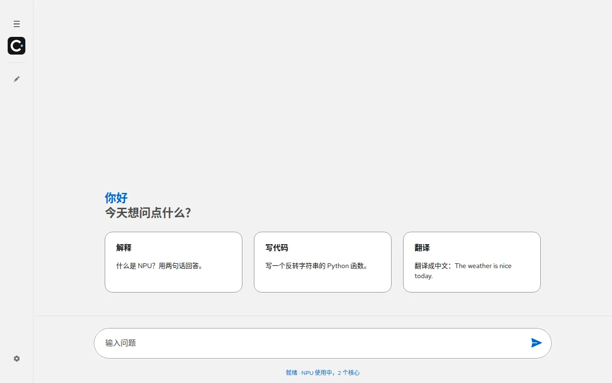
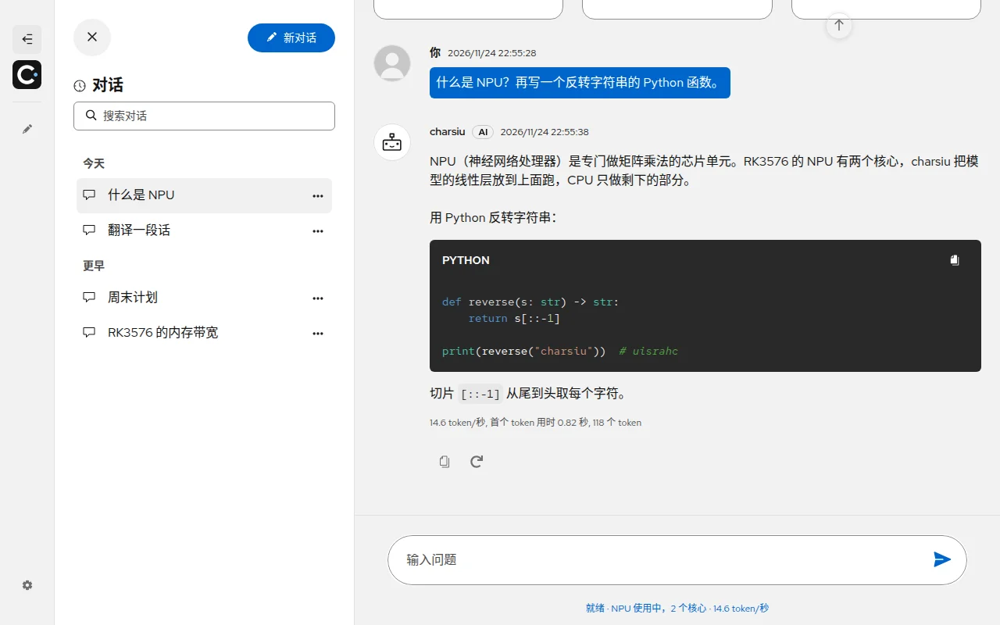
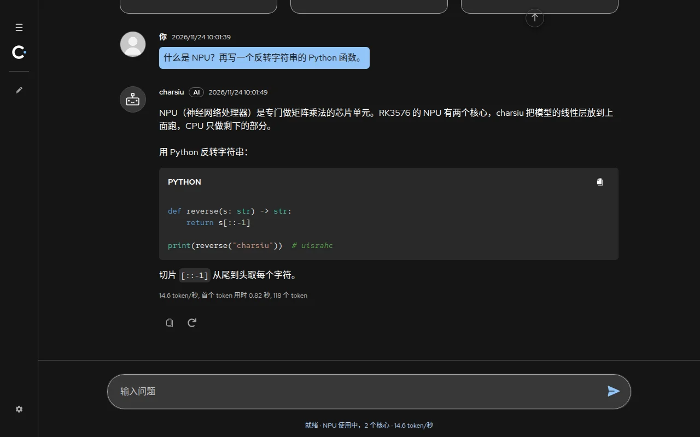

# Charsiu Desktop

[English](README.md)

[charsiu](https://github.com/gahingwoo/charsiu) 的聊天窗口。charsiu 是在 RK3576 NPU 上运行大模型的开源运行时。模型在开发板的 NPU 上运行，对话保存在开发板上（可导出为 Markdown 文件，不会上传），模型下载好之后不需要联网。同一个程序可在 Windows on Arm 和 Linux 上运行，只是下面的 charsiu 不同。



| | |
|---|---|
|  |  |
|  |  |

## 运行环境

- 装有 charsiu 的 RK3576 开发板，以及一个它能运行的模型（没有模型时，可以在程序的“设置”、“模型文件”中下载）。
- Windows 11 arm64，装有 rknpu 驱动（[woa-rk3576-npu](https://github.com/gahingwoo/woa-rk3576-npu)），或者
- Linux arm64，使用主线的 rocket 驱动（Armbian 的 edge 内核已包含）。

没有 NPU 驱动时，charsiu 会用 CPU 回答，慢好几倍，程序会给出提示。

## 安装

Windows：

1. 在 PowerShell 中安装 charsiu（第一次以管理员身份运行，这样普通用户也能使用 NPU）：
   `irm https://raw.githubusercontent.com/gahingwoo/woa-rk3576-npu/main/win/charsiu-install.ps1 | iex`
2. 从最新一次 [Build 运行](https://github.com/gahingwoo/charsiu-desktop/actions/workflows/build.yml)的 `charsiu-desktop-windows-arm64` 产物中运行 `Charsiu Desktop_<版本>_arm64-setup.exe`，它安装到当前用户。

Linux：

1. Armbian 上 `sudo apt install charsiu`，其他系统用 charsiu 的安装脚本。
2. 用 `charsiu-desktop-linux-arm64-deb` 产物：`sudo apt install ./charsiu-desktop_<版本>_arm64.deb`。

从菜单启动 Charsiu Desktop。一个模型第一次启动大约需要一分钟（charsiu 要写权重缓存），之后只需几秒。

## 构建

页面需要 Node 22 和 npm，程序需要 Rust（stable）和 Tauri CLI：

```
npm ci
npm run typecheck
npm run build
cargo install tauri-cli --version =2.12.6 --locked
cd src-tauri
cargo tauri build --bundles deb                                    # Linux arm64
cargo tauri build --target aarch64-pc-windows-msvc --bundles nsis  # Windows arm64
```

Linux 需要 `libwebkit2gtk-4.1-dev libgtk-3-dev librsvg2-dev libsoup-3.0-dev`，Windows 需要 Visual Studio 的 ARM64 构建工具。更多细节（工作原理、CI、在开发板上的测试步骤）见英文 [README](README.md)。

本页截图由 `npm run readme-shots` 生成（Chrome 加模拟后端），写到 `docs/imgs`。顶部的动图由 `npm run demo-gif` 录制（同样的模拟后端，需要 ffmpeg），每次推送到 main 时由 CI 重新录制，作为 `readme-media` 分支的唯一提交强制推送，不进入 main 的历史。

## 许可证

GPL-2.0-only。
